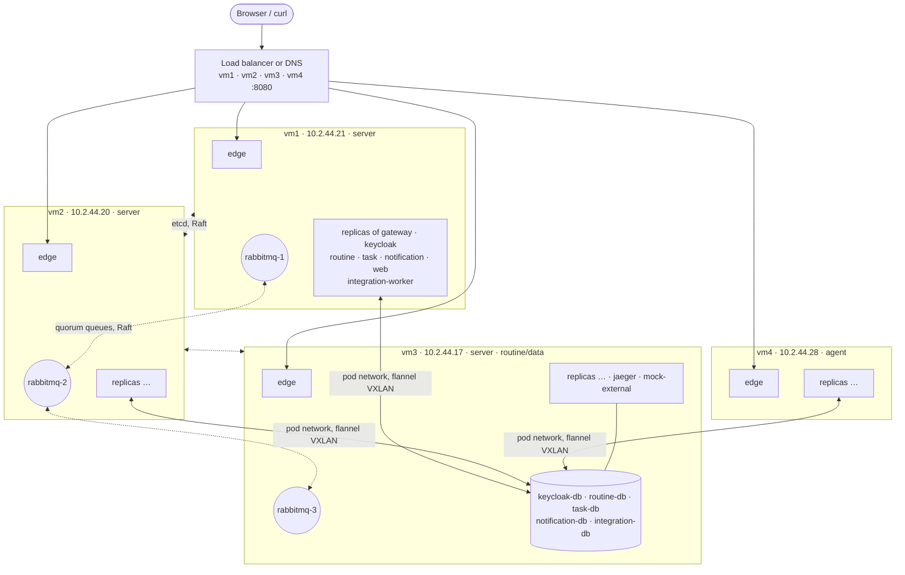

# Deployment on the VMs (Kubernetes)

`compose.yaml` runs the whole platform on **one** host (development, demo). This document covers the
production-like variant: the same containers on a **Kubernetes cluster of three VMs** (k3s) – plus vm4 as a worker
once it is available again – so that losing a whole VM does not take the platform down. The deployment is automated: **one script, run on vm1**, sets up the cluster
and starts the application. **Step by step, with checks and what to do when something fails:
[deployment-guide.md](deployment-guide.md).**

```bash
# on vm1 (10.2.44.21), as a user with sudo
git clone <this repository> routine && cd routine
deploy/deploy.sh          # access → cluster → images → app → verify
```

The VMs are listed in [`deploy/cluster.env`](../deploy/cluster.env):

| VM | Address | Kubernetes role | Workload pinned to it |
| --- | --- | --- | --- |
| vm1 | 10.2.44.21 | server (control plane + etcd), starts the cluster | `rabbitmq-1`; builds the images |
| vm2 | 10.2.44.20 | server (control plane + etcd) | `rabbitmq-2` |
| vm3 | 10.2.44.17 | server (control plane + etcd) | `rabbitmq-3`; the five PostgreSQL databases |
| vm4 | 10.2.44.28 | agent (worker) – temporarily unavailable, joins on the next `deploy.sh` run ([§5](#adding-vm4-or-another-worker)) | – (edge and service replicas only) |

## 1. Target topology



*Example placement: Kubernetes decides where the stateless replicas run. It keeps the two replicas of every
service on different VMs and starts lost replicas on the remaining VMs when a VM fails.*

| What | Where | Why |
| --- | --- | --- |
| Control plane (k3s servers, embedded etcd) | vm1, vm2, vm3 | etcd needs a majority: three members tolerate the loss of one VM. A fourth member would not tolerate more (a majority of four is three), so vm4 joins as an agent |
| Workers (k3s agents) | vm4, and every further `VMn` in `deploy/cluster.env` | Capacity and one more edge; they hold no data and no broker node, so they can fail or be removed without any impact |
| `edge` (nginx, DaemonSet) | every VM, `hostPort` **8080** | Each VM takes requests with its own edge – never forwarded to a VM that just died; a load balancer / DNS in front spreads them |
| `rabbitmq-1..3` (StatefulSet) | one per VM labelled `routine/rabbitmq` (vm1–vm3) | 3 replicas per quorum queue, one per VM – one VM can fail |
| gateway, keycloak, routine, task, notification, web (Deployments) | 2 replicas each, required pod anti-affinity | Never both replicas on the same VM; the two Keycloak replicas form one cluster (discovery through keycloak-db) |
| integration-worker | 3 replicas, spread over the VMs | Competing consumers, scale freely |
| 5 PostgreSQL databases (StatefulSets) | vm3 (label `routine/data`) | A volume (k3s local-path) lives on one VM; pinning keeps the data where the database runs. Not vm1, which builds the images |
| jaeger, mock-external | anywhere, 1 replica | Not in the critical path; started on another VM 30 s after a VM failure (Jaeger loses its in-memory traces). mock-external keeps its simulation state in memory, so it is not replicated |

The manifests are plain Kubernetes YAML in [`deploy/k8s/`](../deploy/k8s), combined with Kustomize (built into
`kubectl`). `deploy.sh` renders an overlay on top (`deploy/.generated/`, never committed): the image tag,
`PUBLIC_URL`, the generated secrets and the configuration files from `infra/` (broker configuration and
definitions, edge configuration). Config maps and secrets are named by a hash of their content, so a changed
configuration rolls the pods that use it.

## 2. Why Kubernetes (k3s)

| Option | Verdict |
| --- | --- |
| **k3s** (chosen) | A certified Kubernetes distribution in one binary: embedded etcd for an HA control plane on three VMs, containerd, flannel networking and local volumes included. Standard Kubernetes objects – what is learned here applies to every Kubernetes. Self-healing, rolling updates, anti-affinity, probes, StatefulSets with stable network identities for the broker nodes |
| kubeadm / full Kubernetes | Same API, but CNI, storage and HA etcd have to be chosen and installed separately – a lot more moving parts for three VMs |
| Docker Swarm (previous deployment) | Simpler, but a niche: placement, health and update rules are Swarm-specific, no StatefulSets, no startup probes |

## 3. Requirements

**VMs** (3×, plus any number of workers such as vm4): Linux with systemd (recommended: Ubuntu 24.04 LTS), 2 vCPU, 4 GB RAM, 20 GB disk, in the same network
with the fixed addresses above, and internet access (k3s release download, public images such as `postgres` and
`rabbitmq`).

**Access**: you log in to vm1 and run `deploy/deploy.sh` there as a user with `sudo`. vm1 reaches the other VMs over SSH
as the user `routine` (`SSH_USER` in `deploy/cluster.env`) with vm1's key: `deploy.sh key` prints a line that
whoever manages vm2, vm3 and vm4 runs there once – it runs [`deploy/prepare-vm.sh`](../deploy/prepare-vm.sh), which creates
that user with vm1's public key and `sudo` without password, installs the basics and opens an active firewall
([deployment-guide.md](deployment-guide.md), steps 1–2). vm1 installs `docker.io` (to build the images), `curl`, `jq` and `openssl` from the distribution's
packages if missing.

**Network**: open these ports between the VMs, and the public ones to your users:

| Port | Protocol | Between | Purpose |
| --- | --- | --- | --- |
| 6443 | TCP | VMs (+ admins) | Kubernetes API (k3s servers) |
| 2379–2380 | TCP | vm1–vm3 | etcd (control plane, Raft) |
| 10250 | TCP | VMs | kubelet (logs, exec, metrics) |
| 8472 | UDP | VMs | flannel VXLAN – all pod traffic between VMs |
| 22 | TCP | vm1 → the other VMs; admins → vm1 | SSH (deploy.sh installs k3s and imports images over SSH) |
| 8080 | TCP | users → VMs | UI and API (edge) |
| 15672 | TCP | **admins only** → VMs | RabbitMQ management (NodePort; password from the secrets file) |
| 16686 | TCP | **admins only** → VMs | Jaeger (NodePort) – has **no login**, so never open it to users or the internet |

Everything else (databases, broker ports 5672/4369/25672, mock-external) stays inside the cluster and is not
published. Restrict 6443/2379–2380/10250/8472 to the VMs. The pod traffic on 8472/udp (VXLAN) is not
encrypted – on a network you do not trust, switch k3s to `flannel-backend: wireguard-native` (add it to
`k3s_config` in `deploy.sh`; then 51820/udp instead of 8472/udp). Not enabled by default because it is untested in
this setup.

The node-port range is set to 15000–32767 so the admin tools keep their usual ports (the UI links to `:15672` and
`:16686` of the host it was opened on).

## 4. Automated deployment

`deploy/deploy.sh` (or `npm run deploy:k8s`) on vm1. Every step is idempotent: run it again after a failure or after
a code change.

| Step | Command | What happens |
| --- | --- | --- |
| 0 | `deploy.sh key` | Once, before everything: creates vm1's SSH key and prints the line for the other VMs (`deploy/prepare-vm.sh` with that key, from GitHub at this commit) |
| 1 | `deploy.sh access` | Checks that it runs on vm1, SSH with vm1's key to every other VM of `deploy/cluster.env` and `sudo` on every VM |
| 2 | `deploy.sh cluster` | Installs k3s with the official installer (it verifies the binary's checksum) and writes `/etc/rancher/k3s/config.yaml` on every VM: vm1 starts the cluster (`cluster-init`), vm2 and vm3 join as **servers** one after the other, vm4 (and any further VM) as **agent**. A worker that was reinstalled loses its k3s node password, which the cluster would refuse – its old registration is removed first. Every VM gets the same version (vm1's, or the current stable release for a new cluster); Traefik and ServiceLB are disabled (the platform brings its own edge). Pod traffic between the VMs (flannel VXLAN) uses the interface of the VM's address, also on VMs with a second network card. Node labels `routine/rabbitmq` (vm1–vm3) and `routine/data` (vm3). Copies the kubeconfig to `~/.kube/config` on vm1 if there is none and sets `KUBECONFIG` in `~/.bashrc` |
| 3 | `deploy.sh images` | Builds the 8 service images **on vm1** with Docker and imports them into the containerd of every VM (`k3s ctr images import`) – no registry needed. Tag = git commit, plus a content hash when there are uncommitted changes. Skipped when every VM has the images already |
| 4 | `deploy.sh app` | Generates the secrets on the first run (below), renders the overlay and `kubectl apply -k`. The overlay writes the list of VMs into every Deployment's pod template (annotation `routine/vms`): when a VM is added, the Deployments roll once and the scheduler spreads their replicas over all VMs. Waits until every StatefulSet, Deployment and DaemonSet is rolled out, then until **every quorum queue has a replica on every broker node** (`rabbitmq-queues grow`) – only then may a VM fail. Removes config maps and secrets of earlier versions |
| 5 | `deploy.sh verify` | Runs the main workflow (`scripts/demo.sh main`) against `PUBLIC_URL` and checks that every VM answers on :8080 |

Afterwards: UI on `http://10.2.44.21:8080` (`demo@routine.local` / `demo12345`), RabbitMQ on
`http://<any VM>:15672` (user `routine`, password `RABBITMQ_PASSWORD` from the secrets file), Jaeger on
`http://<any VM>:16686`, Keycloak's admin console on `<PUBLIC_URL>/auth/admin`.

**Open the platform at exactly `PUBLIC_URL`** (default `http://10.2.44.21:8080`; set it in `deploy/cluster.env` when
a load balancer or DNS name sits in front – without a default port such as `:80`, Keycloak drops it from the
issuer). Keycloak puts this URL into every token as issuer, and only redirects back to it after sign-in – opening
the UI through another VM's address ends with "Invalid redirect uri". The other VMs' `:8080` still serve API calls
and are the load balancer's targets.

### Secrets

The single-host `compose.yaml` uses well-known development passwords (`routine`/`routine` …). The VM deployment
never does: on its first run `deploy.sh` writes random values (`openssl rand`) to `deploy/cluster.secrets.env` on
vm1 – mode 600, in `.gitignore` – and turns them into the Kubernetes secret `routine-secrets`.

| Secret | Used for |
| --- | --- |
| `K3S_TOKEN` | joins the other VMs to the cluster – whoever has it can join a machine to the cluster |
| `RABBITMQ_PASSWORD` | broker user `routine` (services, management UI); written into the rendered broker definitions |
| `RABBITMQ_ERLANG_COOKIE` | shared secret of the broker nodes – whoever has it controls the broker cluster |
| `<SERVICE>_DB_PASSWORD` (5×) | one password per database, Keycloak's included |
| `KEYCLOAK_ADMIN_PASSWORD` | Keycloak admin console (`<PUBLIC_URL>/auth/admin`, user `admin`) – only on the first start: Keycloak creates the admin once |

**Keep the secrets file** (e.g. in your password manager): PostgreSQL sets a password only when it creates the
database, so a regenerated file locks the services out of the existing data. The secrets reach the containers as
environment variables from the Kubernetes secret, readable by whoever has cluster-admin access (the kubeconfig on
the servers). The demo account's password is public on purpose.

#### New passwords (rotation)

```bash
deploy/rotate-secrets.sh                      # on vm1: every password below
deploy/rotate-secrets.sh TASK_DB_PASSWORD     # or only some
```

Because the components keep a password from their first start (see above), a new value in the secrets file alone
would lock the services out. [`deploy/rotate-secrets.sh`](../deploy/rotate-secrets.sh) therefore changes each
password **in the running component first** and writes it to `deploy/cluster.secrets.env` right after – the file
always holds what the components accept, even if the script stops halfway. Then it runs `deploy.sh app verify`
with the image tag that runs now: the pods roll onto the new values and the main workflow is checked. Copy the
file to your password manager again afterwards.

| Password | Changed in the running component with |
| --- | --- |
| `KEYCLOAK_ADMIN_PASSWORD` | Keycloak's admin CLI (`kcadm.sh set-password`) – needs the current password; if it was changed in the admin console, set the new one there by hand |
| `RABBITMQ_PASSWORD` | `rabbitmqctl change_password` – once for the whole broker cluster |
| `<SERVICE>_DB_PASSWORD` (5×) | `ALTER ROLE … PASSWORD` over the database pod's local socket |

The new values travel on stdin into the pods, never on vm1's command line. Until the pods have rolled (2–3 min),
an old replica that opens a new database or broker connection is refused; messages are retried. The databases
restart once (seconds each) and the broker nodes one after the other, because the Kubernetes secret changes.
Measured in the sandbox (§8): 6 of 864 requests failed – the sign-in page for 3 s while Keycloak's replicas formed
their cluster again – the API and the main workflow none.

Not rotated by the script:

| Secret | Why |
| --- | --- |
| `K3S_TOKEN` | Every VM keeps it in `/etc/rancher/k3s/routine-token` – a change means `k3s token rotate` on a server and a new token file plus restart on every VM. It lets machines *join* the cluster; with the API (6443) reachable only between the VMs, leave it unless the file leaked |
| `RABBITMQ_ERLANG_COOKIE` | Nodes with different cookies cannot talk to each other, so a rolling change splits the broker; it needs all three nodes stopped at once (downtime). The broker ports stay inside the cluster's pod network |

## 5. Operation

On vm1 (`kubectl` works in a new shell after `deploy.sh cluster`; otherwise `sudo k3s kubectl`):

| Task | Command |
| --- | --- |
| Status: nodes, pods, placement | `deploy/deploy.sh status` |
| Deploy a new version (rolling, zero downtime) | `git pull && deploy/deploy.sh images app` → each Deployment replaces one replica at a time (`maxUnavailable: 0`); a new replica must be ready before an old one stops |
| Roll back a service | `kubectl -n routine rollout undo deployment/routine-service` |
| Scale the worker | `kubectl -n routine scale deployment/integration-worker --replicas=6` |
| Logs of a service (all replicas) | `kubectl -n routine logs -f -l app=routine-service --prefix` |
| Change configuration (e.g. evolution demo) | `kubectl -n routine set env deployment/routine-service EXECUTION_COMPLETED_FORMAT=expand` (rolling); for good: edit `deploy/k8s/services.yaml`, `deploy.sh app` |
| Take a VM out for maintenance | `kubectl drain vm2 --ignore-daemonsets` → replicas move away (a broker node or database stays down until the VM is back); afterwards `kubectl uncordon vm2` |
| Remove the application (data stays) | `deploy/deploy.sh destroy` – the volumes stay; `deploy.sh app` brings it back with the same data |
| Remove k3s from a VM | `/usr/local/bin/k3s-uninstall.sh` – **deletes the volumes** |
| New passwords | `deploy/rotate-secrets.sh` ([§4, Secrets](#new-passwords-rotation)) |
| Add a worker (vm4) | below |

### Adding vm4 (or another worker)

vm4 (10.2.44.28) is in `deploy/cluster.env` as a worker. While it is unavailable, `deploy.sh access` stops with
`vm4: no SSH access` – comment out `VM4=` to deploy without it. Once it is back:

1. On vm4, whoever manages it pastes the line of `deploy/deploy.sh key` (from vm1) – as for vm2 and vm3. Needed
   again after a reinstall; it is safe to repeat.
2. On vm1: `git pull`, then `deploy/deploy.sh` (inside `tmux`).

`deploy.sh` installs k3s on vm4 as agent, imports the images there, rolls the Deployments once so that their
replicas spread onto vm4 (zero downtime, like an update) and finally checks that vm4 answers on :8080. vm1–vm3,
the databases and the broker stay as they are. Another worker: add `VM5=<address>` the same way.

If vm4 was reinstalled, two more things may come up – `deploy.sh` handles the second itself:

| Message | Cause, fix |
| --- | --- |
| `vm4: its SSH host key changed` | vm1 knows vm4's old host key. If the reinstall is expected: `ssh-keygen -R 10.2.44.28` on vm1, run `deploy.sh` again |
| `vm4: removed its old registration in the cluster` | Not an error: k3s would refuse vm4's new node password while the old `vm4` is registered ("Node password rejected"), so `deploy.sh` deletes the old node first |

### Demo scenarios on the VMs

`scripts/demo.sh` scenarios that only use HTTP run unchanged against the VMs:
`GATEWAY=http://10.2.44.21:8080 RABBIT=http://10.2.44.21:15672 RABBIT_AUTH=routine:<password> scripts/demo.sh main`
(also `retry`, `idempotency`, `webhook`, `schedule`). The scenarios that stop containers use `docker compose` and
belong to the single-host setup. On the VMs, the same effects come from Kubernetes:

| Scenario | On the VMs |
| --- | --- |
| Resilience (consumer down, messages wait) | `kubectl -n routine scale deployment/integration-worker --replicas=0`, trigger a routine, watch the queue on :15672, scale back to 3 |
| Scaling | `kubectl -n routine scale deployment/integration-worker --replicas=6` |
| Self-healing | `kubectl -n routine delete pod -l app=gateway --wait=false` – the Deployment starts new replicas, the edge fails over meanwhile |
| Failover | Power off a VM (or `sudo systemctl stop k3s` on it) |

## 6. Failure behaviour

| Failure | What happens | Recovery |
| --- | --- | --- |
| A replica crashes | Kubernetes restarts it; the other replica serves meanwhile | automatic |
| vm2 fails | etcd keeps 2/3 members (majority), the API stays up; its edge drops out of the load balancer; broker keeps 2/3 nodes; the surviving replica of each service serves at once (measured: no failed request); jaeger and mock-external (one replica) start on another VM after 30 s, the other lost replicas after ~5 min (`NoExecute` toleration) | automatic; when the VM comes back, its broker node rejoins |
| vm1 fails | As vm2 – the cluster DNS has a second replica on another VM (`deploy.sh cluster`). vm2 and vm3 keep the cluster running. Without a load balancer, users lose the UI: `PUBLIC_URL` is vm1's address. `deploy.sh` and the kubeconfig live on vm1, so administer from vm2 (`sudo k3s kubectl`) until vm1 is back | restart vm1 |
| vm4 fails | Only replicas and an edge: the other replica of each service serves at once, the edges of vm1–vm3 keep answering. Control plane, broker and databases are not on vm4 | automatic |
| vm3 fails | As vm2 – and the databases are gone: logins, routines and tasks are unavailable until vm3 is back. Broker (2/3 nodes), edge and replicas keep running; messages wait in the broker | restart vm3 – data is on its volumes |
| Two VMs fail | etcd and/or the broker lose their majority: the cluster cannot change anything, queues stop (the outbox keeps every state change) | bring one VM back |

vm3 is the remaining single point of failure for the data: it holds all five database volumes. Spreading the
databases over the VMs would not remove that – every VM would then hold *some* critical data, so any VM loss would
break something. Pinned to one VM, vm1 and vm2 can fail without data impact.
The real fix is a replicated database, e.g. CloudNativePG on this cluster
(see [availability.md §3](availability.md#3-what-remains-on-purpose)).

## 7. What is not automated, and why

| Step | Why it is not in `deploy.sh` | What to do |
| --- | --- | --- |
| Creating the VMs | Depends on the platform (TBZ lab, VMware, Proxmox, a cloud) – there is no common API | Create 3 Ubuntu VMs (4 with the worker) with the specs and addresses from §3, then run `deploy.sh` on vm1 |
| Firewall / security groups | Also platform-specific (cloud security group, `ufw`, a lab firewall) | Open the ports from §3 |
| Load balancer or DNS in front of the VMs | Needs infrastructure outside the VMs (cloud LB, keepalived with a floating IP, or DNS with one A record per VM) | Point it at `vm1..4:8080` with a health check on `/edge/health`. Without it, users use vm1's address |
| TLS certificates | Need a domain name | Terminate TLS at the load balancer |

## 8. Tested

**vm4 as worker and the password rotation, 2026-10-30** – in a sandbox with k3s v1.36.5 in containers, with the
addresses of `deploy/cluster.env`: three servers, the application deployed by `deploy.sh app verify`, then vm4
joined as agent. Requests through vm2, vm3 and vm4 every 0.5 s meanwhile. (Not covered by the sandbox: the SSH and
installer part of `deploy.sh cluster` and `images` for vm4 – the same code that installed the agent on four VMs
before, see below.)

| Test | Result |
| --- | --- |
| Three VMs (`VM4` commented out), `deploy.sh app verify` | all ✔; 28 pods on vm1–vm3, 0 restarts |
| `VM4` back in `deploy/cluster.env`, vm4 joined, `deploy.sh app verify` again | the Deployments rolled once: vm4 got 10 pods (edge and one replica each of gateway, keycloak, routine, task, notification, web, worker, jaeger, mock-external); databases and broker unchanged; main workflow ✔, all four VMs answer on :8080; 1 of 204 requests failed (web UI, during the rolling update – a plain `rollout restart` of web and gateway without vm4 shows the same: 2 of 190) |
| `deploy/rotate-secrets.sh` (all seven passwords) | ✔ in 2 min 38 s; every old password refused, every new one accepted (broker API, Keycloak admin, PostgreSQL over the network); secrets file still mode 600; 29 pods, 0 restarts; main workflow ✔; 6 of 864 requests failed – the sign-in page for 3 s, while both Keycloak replicas reported their cluster check down |
| `deploy/rotate-secrets.sh KEYCLOAK_DB_PASSWORD` | ✔; **0 of 436** requests failed |
| vm4 replaced by a fresh one (new node password) | k3s refused it ("Node password rejected, duplicate hostname") until the old node and its `vm4.node-password.k3s` secret were deleted – which `deploy.sh cluster` now does for a worker where k3s is not running |

**On three VMs – the layout without vm4, 2026-10-29**: Ubuntu 24.04 (arm64, qemu, 4 GB RAM each) with the addresses of
`deploy/cluster.env` (vm1 10.2.44.21, vm2 10.2.44.20, vm3 10.2.44.17), untouched as in the guide: firewall (`ufw`)
on, no `tmux`, password SSH off on vm2 and vm3, a user `student` everywhere.

| Test | Result |
| --- | --- |
| The guide from step 1: `deploy.sh key` on vm1, its line pasted on vm2 and vm3, `deploy.sh access`, `deploy.sh` inside `tmux` | all ✔, only prompt: the sudo password on vm1; 3 control-plane nodes, 28 pods ready, **0 restarts**; databases on vm3; memory used 1.4 / 1.7 / 2.0 GB of 3.9 GB |
| Browser through a tunnel to vm1: `http://10.2.44.21:8080`, "Try the demo" | signed in through Keycloak; RabbitMQ and Jaeger reachable |
| vm2 powered off, main workflow through vm1 for 2 minutes | **39 of 40** succeeded – one failed after 62 s, while Kubernetes declared vm2 dead and moved its traffic |

**Before, on four VMs** (vm4 = databases), 2026-10-29: Ubuntu 24.04 (arm64, qemu), one user with
password login and `sudo` *with* password, a second network card for internet access (NAT) – the setup of many lab
networks. `deploy/deploy.sh` ran unchanged on vm1, as in [deployment-guide.md](deployment-guide.md).

| Test | Result |
| --- | --- |
| Fresh VMs: pre-flight of the guide, `git clone`, `deploy/deploy.sh` – passwords typed only at the start | all steps ✔ in **7 min 49 s**; 29 pods ready, **0 restarts**; main workflow `COMPLETED`; every VM answers on :8080 |
| Untouched VMs as in the guide: firewall (`ufw`) on, no `tmux`, password SSH off on two VMs, other user names than `routine` – `deploy.sh key` on vm1, its line pasted on vm2–vm4, `deploy.sh` inside `tmux` | `prepare-vm.sh` ✔ on all four (and again, unchanged); `deploy.sh access` ✔ without any password of vm2–vm4; deployment all ✔ |
| Browser through a tunnel to vm1 (like the VPN): `http://10.2.44.21:8080`, "Try the demo" | signed in through Keycloak, overview shown; a routine started from the UI (202); RabbitMQ on :15672, Jaeger on :16686 |
| Update: new commit, `deploy.sh images app`, requests every 0.5 s through two other VMs meanwhile | 8 new images, rolling update, **0 of 188** requests failed |
| vm2 powered off, requests through vm1 and vm3 | **0 of 184** failed; vm2 back: rejoined, broker again 3 nodes |
| vm3 powered off (with jaeger and mock-external on it) | requests through vm1: failed for ~20 s, then all fine; main workflow again `COMPLETED` after **75 s** (mock-external restarted on vm1 after 30 s) |
| vm1 powered off, main workflow through vm2 for 2 minutes | **73 of 73** succeeded |
| `deploy.sh` again on a running cluster, with changed k3s configuration | every VM restarted one after the other with the new configuration, application unchanged |

Six findings from these tests are fixed in `deploy.sh` and the manifests: pod traffic took the default route's
network card instead of the VM's address (`flannel-iface`); a changed k3s configuration was never loaded (the
installer restarts k3s only for its own changes); the sign-in did not work in browsers on plain HTTP (no
`crypto.subtle` outside HTTPS/localhost – `web/src/insecure-context.ts`); with vm1 off the platform was down for
almost 8 minutes (one CoreDNS replica, on vm1); jaeger and mock-external came back only after 5 min 40 s
(now 30 s); `kubectl` without `sudo` did not work for the admin on vm1.

Earlier, in a sandbox with k3s in containers (2026-10-23): the cluster formation of `deploy.sh cluster`, and the
manifests on one node (26 pods, no restarts, 29 quorum queues with 3 replicas).

Two findings from the sandbox tests are built into the manifests:

* Services listen only once their database and the broker answer. Without a `startupProbe`, the liveness probe
  killed them during the first start; now they get up to 5 minutes.
* The broker's probes call RabbitMQ's CLI. As root, the first call created the Erlang cookie file before the
  broker did, and the broker (user `rabbitmq`) could not read it. The broker pods therefore run as `rabbitmq`
  (`runAsUser: 100`).

## 9. Troubleshooting

| Symptom | Cause / fix |
| --- | --- |
| `deploy.sh access` fails for a VM | The line of `deploy.sh key` has not run on that VM, or failed there. From vm1: `ssh routine@10.2.44.20` – port 22 blocked, or `deploy.sh` run with `sudo` (then it uses root's key instead of yours). A worker that is down for longer (vm4): comment out its `VMn=` line |
| `its SSH host key changed` | The VM was reinstalled. If that is expected: `ssh-keygen -R <address>` on vm1 |
| A worker's k3s log: `Node password rejected, duplicate hostname` | The old registration of a reinstalled VM – `deploy.sh cluster` removes it when k3s is not running there; by hand: `kubectl delete node vm4`, `kubectl -n kube-system delete secret vm4.node-password.k3s` |
| `rotate-secrets.sh`: `Keycloak refused the current password` | `KEYCLOAK_ADMIN_PASSWORD` in the secrets file is not the admin's password any more (changed in the console). Set a new one in the admin console and write it into the file |
| A VM does not become `Ready` after joining | On that VM: `journalctl -u k3s`, installer log in `/var/log/routine-k3s-install.log`. Usually ports 6443/2379–2380/8472 between the VMs (§3) |
| Pods stay `Pending` | `kubectl -n routine describe pod <pod>`: anti-affinity with too few `Ready` VMs, or a missing node label (`deploy.sh cluster` sets them) |
| `ErrImageNeverPull` | The image of this tag is missing on that VM – `deploy.sh images` |
| `deploy.sh app` waits for `rabbitmq` | The broker nodes cannot reach each other: pod traffic between VMs (8472/udp). `kubectl -n routine logs rabbitmq-1` |
| Services cannot reach each other across VMs, but work on the same VM | Flannel's VXLAN (8472/udp) blocked, or the MTU too small (some clouds). `ip -d link show flannel.1` on a VM must show `local <its 10.2.44.x address>` |
| `password authentication failed` / broker login refused after redeploying | The secrets file was lost or regenerated, but the volumes still hold the old passwords. Restore the file – or, if the data may go, `kubectl delete namespace routine` (deletes the volumes) and `deploy.sh app` |
| Browser: "Sign-in is unavailable right now" | The web image is older than the fix for plain HTTP (`deploy.sh images app`), or `/auth` is not reachable: `curl http://10.2.44.21:8080/auth/realms/routine` on vm1 |
| A pod fails with `exec format error` after a VM lost power | A half-written image on that VM: `sudo k3s crictl rmi <image>` there, then `kubectl -n routine delete pod <pod>` |
| Sign-in fails with "HTTPS required" | The realm requires HTTPS for requests from public IP addresses (`sslRequired: external`). Use a private address, or terminate TLS at a load balancer |
