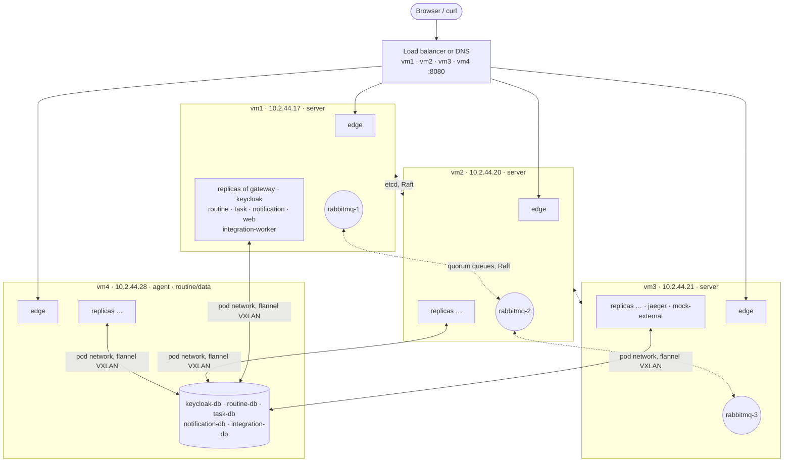

# Deployment on four VMs (Kubernetes)

`compose.yaml` runs the whole platform on **one** host (development, demo). This document covers the
production-like variant: the same containers on a **Kubernetes cluster of four VMs** (k3s), so that losing a whole
VM does not take the platform down. The deployment is automated: **one script, run on vm1**, sets up the cluster
and starts the application. **Step by step, with checks and what to do when something fails:
[deployment-guide.md](deployment-guide.md).**

```bash
# on vm1 (10.2.44.17), as a user with sudo
git clone <this repository> routine && cd routine
deploy/deploy.sh          # access → cluster → images → app → verify
```

The four VMs are listed in [`deploy/cluster.env`](../deploy/cluster.env):

| VM | Address | Kubernetes role | Workload pinned to it |
| --- | --- | --- | --- |
| vm1 | 10.2.44.17 | server (control plane + etcd), starts the cluster | `rabbitmq-1`; builds the images |
| vm2 | 10.2.44.20 | server (control plane + etcd) | `rabbitmq-2` |
| vm3 | 10.2.44.21 | server (control plane + etcd) | `rabbitmq-3` |
| vm4 | 10.2.44.28 | agent (worker) | the five PostgreSQL databases |

## 1. Target topology



*Example placement: Kubernetes decides where the stateless replicas run. It keeps the two replicas of every
service on different VMs and starts lost replicas on the remaining VMs when a VM fails.*

| What | Where | Why |
| --- | --- | --- |
| Control plane (k3s servers, embedded etcd) | vm1, vm2, vm3 | etcd needs a majority: three members tolerate the loss of one VM. A fourth member would not tolerate more (majority of 4 = 3), so vm4 is a plain worker |
| `edge` (nginx, DaemonSet) | every VM, `hostPort` **8080** | Each VM takes requests with its own edge – never forwarded to a VM that just died; a load balancer / DNS in front spreads them |
| `rabbitmq-1..3` (StatefulSet) | one per VM labelled `routine/rabbitmq` (vm1–vm3) | 3 replicas per quorum queue, one per VM – one VM can fail |
| gateway, keycloak, routine, task, notification, web (Deployments) | 2 replicas each, required pod anti-affinity | Never both replicas on the same VM; the two Keycloak replicas form one cluster (discovery through keycloak-db) |
| integration-worker | 3 replicas, spread over the VMs | Competing consumers, scale freely |
| 5 PostgreSQL databases (StatefulSets) | vm4 (label `routine/data`) | A volume (k3s local-path) lives on one VM; pinning keeps the data where the database runs |
| jaeger, mock-external | anywhere, 1 replica | Not in the critical path; started on another VM 30 s after a VM failure (Jaeger loses its in-memory traces). mock-external keeps its simulation state in memory, so it is not replicated |

The manifests are plain Kubernetes YAML in [`deploy/k8s/`](../deploy/k8s), combined with Kustomize (built into
`kubectl`). `deploy.sh` renders an overlay on top (`deploy/.generated/`, never committed): the image tag,
`PUBLIC_URL`, the generated secrets and the configuration files from `infra/` (broker configuration and
definitions, edge configuration). Config maps and secrets are named by a hash of their content, so a changed
configuration rolls the pods that use it.

## 2. Why Kubernetes (k3s)

| Option | Verdict |
| --- | --- |
| **k3s** (chosen) | A certified Kubernetes distribution in one binary: embedded etcd for an HA control plane on three VMs, containerd, flannel networking and local volumes included. Standard Kubernetes objects – what is learned here applies to every Kubernetes. Self-healing, rolling updates, anti-affinity, probes, StatefulSets with stable network identities for the broker nodes |
| kubeadm / full Kubernetes | Same API, but CNI, storage and HA etcd have to be chosen and installed separately – a lot more moving parts for four VMs |
| Docker Swarm (previous deployment) | Simpler, but a niche: placement, health and update rules are Swarm-specific, no StatefulSets, no startup probes |

## 3. Requirements

**VMs** (4×): Linux with systemd (recommended: Ubuntu 24.04 LTS), 2 vCPU, 4 GB RAM, 20 GB disk, in the same network
with the fixed addresses above, and internet access (k3s release download, public images such as `postgres` and
`rabbitmq`).

**Access**: you log in to vm1 and run `deploy/deploy.sh` there as a user with `sudo`. vm1 reaches vm2–vm4 over SSH
as the user `routine` (`SSH_USER` in `deploy/cluster.env`) with vm1's key: `deploy.sh key` prints a line that
whoever manages vm2–vm4 runs there once – it runs [`deploy/prepare-vm.sh`](../deploy/prepare-vm.sh), which creates
that user with vm1's public key and `sudo` without password, installs the basics and opens an active firewall
([deployment-guide.md](deployment-guide.md), steps 1–2). vm1 installs `docker.io` (to build the images), `curl`, `jq` and `openssl` from the distribution's
packages if missing.

**Network**: open these ports between the VMs, and the public ones to your users:

| Port | Protocol | Between | Purpose |
| --- | --- | --- | --- |
| 6443 | TCP | VMs (+ admins) | Kubernetes API (k3s servers) |
| 2379–2380 | TCP | vm1–vm3 | etcd (control plane, Raft) |
| 10250 | TCP | VMs | kubelet (logs, exec, metrics) |
| 8472 | UDP | VMs | flannel VXLAN – all pod traffic between VMs |
| 22 | TCP | vm1 → vm2–vm4, admins → vm1 | SSH (deploy.sh installs k3s and imports images over SSH) |
| 8080 | TCP | users → VMs | UI and API (edge) |
| 15672 | TCP | **admins only** → VMs | RabbitMQ management (NodePort; password from the secrets file) |
| 16686 | TCP | **admins only** → VMs | Jaeger (NodePort) – has **no login**, so never open it to users or the internet |

Everything else (databases, broker ports 5672/4369/25672, mock-external) stays inside the cluster and is not
published. Restrict 6443/2379–2380/10250/8472 to the four VMs. The pod traffic on 8472/udp (VXLAN) is not
encrypted – on a network you do not trust, switch k3s to `flannel-backend: wireguard-native` (add it to
`k3s_config` in `deploy.sh`; then 51820/udp instead of 8472/udp). Not enabled by default because it is untested in
this setup.

The node-port range is set to 15000–32767 so the admin tools keep their usual ports (the UI links to `:15672` and
`:16686` of the host it was opened on).

## 4. Automated deployment

`deploy/deploy.sh` (or `npm run deploy:k8s`) on vm1. Every step is idempotent: run it again after a failure or after
a code change.

| Step | Command | What happens |
| --- | --- | --- |
| 0 | `deploy.sh key` | Once, before everything: creates vm1's SSH key and prints the line for vm2–vm4 (`deploy/prepare-vm.sh` with that key, from GitHub at this commit) |
| 1 | `deploy.sh access` | Checks that it runs on vm1, SSH with vm1's key to vm2–vm4 and `sudo` on every VM |
| 2 | `deploy.sh cluster` | Installs k3s with the official installer (it verifies the binary's checksum) and writes `/etc/rancher/k3s/config.yaml` on every VM: vm1 starts the cluster (`cluster-init`), vm2 and vm3 join as **servers** one after the other, vm4 joins as **agent**. Every VM gets the same version (vm1's, or the current stable release for a new cluster); Traefik and ServiceLB are disabled (the platform brings its own edge). Pod traffic between the VMs (flannel VXLAN) uses the interface of the VM's address, also on VMs with a second network card. Node labels `routine/rabbitmq` (vm1–vm3) and `routine/data` (vm4). Copies the kubeconfig to `~/.kube/config` on vm1 if there is none and sets `KUBECONFIG` in `~/.bashrc` |
| 3 | `deploy.sh images` | Builds the 8 service images **on vm1** with Docker and imports them into the containerd of every VM (`k3s ctr images import`) – no registry needed. Tag = git commit, plus a content hash when there are uncommitted changes. Skipped when every VM has the images already |
| 4 | `deploy.sh app` | Generates the secrets on the first run (below), renders the overlay and `kubectl apply -k`. Waits until every StatefulSet, Deployment and DaemonSet is rolled out, then until **every quorum queue has a replica on every broker node** (`rabbitmq-queues grow`) – only then may a VM fail. Removes config maps and secrets of earlier versions |
| 5 | `deploy.sh verify` | Runs the main workflow (`scripts/demo.sh main`) against `PUBLIC_URL` and checks that every VM answers on :8080 |

Afterwards: UI on `http://10.2.44.17:8080` (`demo@routine.local` / `demo12345`), RabbitMQ on
`http://<any VM>:15672` (user `routine`, password `RABBITMQ_PASSWORD` from the secrets file), Jaeger on
`http://<any VM>:16686`, Keycloak's admin console on `<PUBLIC_URL>/auth/admin`.

**Open the platform at exactly `PUBLIC_URL`** (default `http://10.2.44.17:8080`; set it in `deploy/cluster.env` when
a load balancer or DNS name sits in front – without a default port such as `:80`, Keycloak drops it from the
issuer). Keycloak puts this URL into every token as issuer, and only redirects back to it after sign-in – opening
the UI through another VM's address ends with "Invalid redirect uri". The other VMs' `:8080` still serve API calls
and are the load balancer's targets.

### Secrets

The single-host `compose.yaml` uses well-known development passwords (`routine`/`routine` …). The VM deployment
never does: on its first run `deploy.sh` writes random values (`openssl rand`) to `deploy/cluster.secrets.env` on
vm1 – mode 600, in `.gitignore` – and turns them into the Kubernetes secret `routine-secrets`.

| Secret | Used for |
| --- | --- |
| `K3S_TOKEN` | joins vm2–vm4 to the cluster – whoever has it can join a machine to the cluster |
| `RABBITMQ_PASSWORD` | broker user `routine` (services, management UI); written into the rendered broker definitions |
| `RABBITMQ_ERLANG_COOKIE` | shared secret of the broker nodes – whoever has it controls the broker cluster |
| `<SERVICE>_DB_PASSWORD` (5×) | one password per database, Keycloak's included |
| `KEYCLOAK_ADMIN_PASSWORD` | Keycloak admin console (`<PUBLIC_URL>/auth/admin`, user `admin`) – only on the first start: Keycloak creates the admin once |

**Keep the secrets file** (e.g. in your password manager): PostgreSQL sets a password only when it creates the
database, so a regenerated file locks the services out of the existing data. The secrets reach the containers as
environment variables from the Kubernetes secret, readable by whoever has cluster-admin access (the kubeconfig on
the servers). The demo account's password is public on purpose.

## 5. Operation

On vm1 (`kubectl` works in a new shell after `deploy.sh cluster`; otherwise `sudo k3s kubectl`):

| Task | Command |
| --- | --- |
| Status: nodes, pods, placement | `deploy/deploy.sh status` |
| Deploy a new version (rolling, zero downtime) | `git pull && deploy/deploy.sh images app` → each Deployment replaces one replica at a time (`maxUnavailable: 0`); a new replica must be ready before an old one stops |
| Roll back a service | `kubectl -n routine rollout undo deployment/routine-service` |
| Scale the worker | `kubectl -n routine scale deployment/integration-worker --replicas=6` |
| Logs of a service (all replicas) | `kubectl -n routine logs -f -l app=routine-service --prefix` |
| Change configuration (e.g. evolution demo) | `kubectl -n routine set env deployment/routine-service EXECUTION_COMPLETED_FORMAT=expand` (rolling); for good: edit `deploy/k8s/services.yaml`, `deploy.sh app` |
| Take a VM out for maintenance | `kubectl drain vm2 --ignore-daemonsets` → replicas move away (a broker node or database stays down until the VM is back); afterwards `kubectl uncordon vm2` |
| Remove the application (data stays) | `deploy/deploy.sh destroy` – the volumes stay; `deploy.sh app` brings it back with the same data |
| Remove k3s from a VM | `/usr/local/bin/k3s-uninstall.sh` (servers) or `k3s-agent-uninstall.sh` (vm4) – **deletes the volumes** |

### Demo scenarios on the VMs

`scripts/demo.sh` scenarios that only use HTTP run unchanged against the VMs:
`GATEWAY=http://10.2.44.17:8080 RABBIT=http://10.2.44.17:15672 RABBIT_AUTH=routine:<password> scripts/demo.sh main`
(also `retry`, `idempotency`, `webhook`, `schedule`). The scenarios that stop containers use `docker compose` and
belong to the single-host setup. On the VMs, the same effects come from Kubernetes:

| Scenario | On the VMs |
| --- | --- |
| Resilience (consumer down, messages wait) | `kubectl -n routine scale deployment/integration-worker --replicas=0`, trigger a routine, watch the queue on :15672, scale back to 3 |
| Scaling | `kubectl -n routine scale deployment/integration-worker --replicas=6` |
| Self-healing | `kubectl -n routine delete pod -l app=gateway --wait=false` – the Deployment starts new replicas, the edge fails over meanwhile |
| Failover | Power off a VM (or `sudo systemctl stop k3s` on it) |

## 6. Failure behaviour

| Failure | What happens | Recovery |
| --- | --- | --- |
| A replica crashes | Kubernetes restarts it; the other replica serves meanwhile | automatic |
| vm2 or vm3 fails | etcd keeps 2/3 members (majority), the API stays up; its edge drops out of the load balancer; broker keeps 2/3 nodes; the surviving replica of each service serves at once (measured: no failed request); jaeger and mock-external (one replica) start on another VM after 30 s, the other lost replicas after ~5 min (`NoExecute` toleration) | automatic; when the VM comes back, its broker node rejoins |
| vm1 fails | As vm2/vm3 – the cluster DNS has a second replica on another VM (`deploy.sh cluster`). vm2/vm3 keep the cluster running. Without a load balancer, users lose the UI: `PUBLIC_URL` is vm1's address. `deploy.sh` and the kubeconfig live on vm1, so administer from vm2 (`sudo k3s kubectl`) until vm1 is back | restart vm1 |
| vm4 fails | The databases are gone: logins, routines and tasks are unavailable until vm4 is back. Broker, edge and replicas keep running; messages wait in the broker | restart vm4 – data is on its volumes |
| Two VMs fail | etcd and/or the broker lose their majority: the cluster cannot change anything, queues stop (the outbox keeps every state change) | bring one VM back |

vm4 is the remaining single point of failure: it holds all five database volumes. Spreading the databases over the
VMs would not remove that – every VM would then hold *some* critical data, so any VM loss would break something.
Pinning them to the one VM without a broker node or etcd member means any other VM can fail without data impact.
The real fix is a replicated database, e.g. CloudNativePG on this cluster
(see [availability.md §3](availability.md#3-what-remains-on-purpose)).

## 7. What is not automated, and why

| Step | Why it is not in `deploy.sh` | What to do |
| --- | --- | --- |
| Creating the VMs | Depends on the platform (TBZ lab, VMware, Proxmox, a cloud) – there is no common API | Create 4 Ubuntu VMs with the specs and addresses from §3, then run `deploy.sh` on vm1 |
| Firewall / security groups | Also platform-specific (cloud security group, `ufw`, a lab firewall) | Open the ports from §3 |
| Load balancer or DNS in front of the VMs | Needs infrastructure outside the VMs (cloud LB, keepalived with a floating IP, or DNS with four A records) | Point it at `vm1..4:8080` with a health check on `/edge/health`. Without it, users use vm1's address |
| TLS certificates | Need a domain name | Terminate TLS at the load balancer |

## 8. Tested

**On four VMs, 2026-10-29**: Ubuntu 24.04 (arm64, qemu), the addresses of `deploy/cluster.env`, one user with
password login and `sudo` *with* password, a second network card for internet access (NAT) – the setup of many lab
networks. `deploy/deploy.sh` ran unchanged on vm1, as in [deployment-guide.md](deployment-guide.md).

| Test | Result |
| --- | --- |
| Fresh VMs: pre-flight of the guide, `git clone`, `deploy/deploy.sh` – passwords typed only at the start | all steps ✔ in **7 min 49 s**; 29 pods ready, **0 restarts**; main workflow `COMPLETED`; every VM answers on :8080 |
| Browser through a tunnel to vm1 (like the VPN): `http://10.2.44.17:8080`, "Try the demo" | signed in through Keycloak, overview shown; a routine started from the UI (202); RabbitMQ on :15672, Jaeger on :16686 |
| Update: new commit, `deploy.sh images app`, requests every 0.5 s through two other VMs meanwhile | 8 new images, rolling update, **0 of 188** requests failed |
| vm2 powered off, requests through vm1 and vm3 | **0 of 184** failed; vm2 back: rejoined, broker again 3 nodes |
| vm3 powered off (with jaeger and mock-external on it) | requests through vm1: failed for ~20 s, then all fine; main workflow again `COMPLETED` after **75 s** (mock-external restarted on vm1 after 30 s) |
| vm1 powered off, main workflow through vm2 for 2 minutes | **73 of 73** succeeded |
| `deploy.sh` again on a running cluster, with changed k3s configuration | every VM restarted one after the other with the new configuration, application unchanged |

Six findings from these tests are fixed in `deploy.sh` and the manifests: pod traffic took the default route's
network card instead of the VM's address (`flannel-iface`); a changed k3s configuration was never loaded (the
installer restarts k3s only for its own changes); the sign-in did not work in browsers on plain HTTP (no
`crypto.subtle` outside HTTPS/localhost – `web/src/insecure-context.ts`); with vm1 off the platform was down for
almost 8 minutes (one CoreDNS replica, on vm1); jaeger and mock-external came back only after 5 min 40 s
(now 30 s); `kubectl` without `sudo` did not work for the admin on vm1.

Earlier, in a sandbox with k3s in containers (2026-10-23): the cluster formation of `deploy.sh cluster`, and the
manifests on one node (26 pods, no restarts, 29 quorum queues with 3 replicas).

Two findings from the sandbox tests are built into the manifests:

* Services listen only once their database and the broker answer. Without a `startupProbe`, the liveness probe
  killed them during the first start; now they get up to 5 minutes.
* The broker's probes call RabbitMQ's CLI. As root, the first call created the Erlang cookie file before the
  broker did, and the broker (user `rabbitmq`) could not read it. The broker pods therefore run as `rabbitmq`
  (`runAsUser: 100`).

## 9. Troubleshooting

| Symptom | Cause / fix |
| --- | --- |
| `deploy.sh access` fails for a VM | The line of `deploy.sh key` has not run on that VM, or failed there. From vm1: `ssh routine@10.2.44.20` – port 22 blocked, or `deploy.sh` run with `sudo` (then it uses root's key instead of yours) |
| A VM does not become `Ready` after joining | On that VM: `journalctl -u k3s` (servers) / `journalctl -u k3s-agent` (vm4), installer log in `/var/log/routine-k3s-install.log`. Usually ports 6443/2379–2380/8472 between the VMs (§3) |
| Pods stay `Pending` | `kubectl -n routine describe pod <pod>`: anti-affinity with too few `Ready` VMs, or a missing node label (`deploy.sh cluster` sets them) |
| `ErrImageNeverPull` | The image of this tag is missing on that VM – `deploy.sh images` |
| `deploy.sh app` waits for `rabbitmq` | The broker nodes cannot reach each other: pod traffic between VMs (8472/udp). `kubectl -n routine logs rabbitmq-1` |
| Services cannot reach each other across VMs, but work on the same VM | Flannel's VXLAN (8472/udp) blocked, or the MTU too small (some clouds). `ip -d link show flannel.1` on a VM must show `local <its 10.2.44.x address>` |
| `password authentication failed` / broker login refused after redeploying | The secrets file was lost or regenerated, but the volumes still hold the old passwords. Restore the file – or, if the data may go, `kubectl delete namespace routine` (deletes the volumes) and `deploy.sh app` |
| Browser: "Sign-in is unavailable right now" | The web image is older than the fix for plain HTTP (`deploy.sh images app`), or `/auth` is not reachable: `curl http://10.2.44.17:8080/auth/realms/routine` on vm1 |
| A pod fails with `exec format error` after a VM lost power | A half-written image on that VM: `sudo k3s crictl rmi <image>` there, then `kubectl -n routine delete pod <pod>` |
| Sign-in fails with "HTTPS required" | The realm requires HTTPS for requests from public IP addresses (`sslRequired: external`). Use a private address, or terminate TLS at a load balancer |
